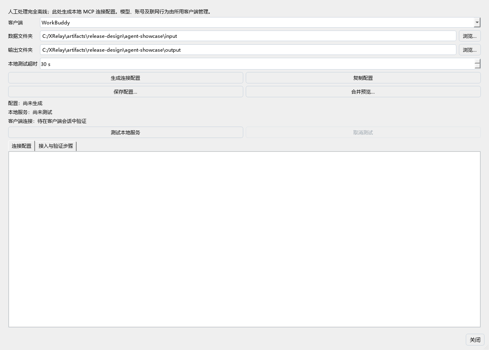

# Connect an AI assistant to XRelay

[English overview](README.md) · [中文说明](AGENT_QUICKSTART.md)

1. In XRelay, open Window → AI Agent interface. Choose allowed input and output directories; keep output outside the raw-data folder.
2. Select the client, generate configuration and test the local service. Merge only the new service entry into the client's settings, preserving existing entries.
3. Reload the client or start a new session. Confirm discovery of saxs-waxs-workbench and try read-only inspection before computation.

WorkBuddy, Codex, Claude Code, Gemini CLI and Grok Build CLI have client-specific templates. DeepSeek Harness uses a native MCP bridge and its Cordis configuration; Grok Build CLI uses TOML. Do not paste a generic mcpServers JSON into an incompatible configuration system. The client must support local MCP stdio; a model name or web chat product does not establish that support. Generic templates are not end-to-end client validation.

Example request: Read the workflow instructions and inspect the allowed files and frames. List available and missing geometry; do not guess wavelength, distance, centre or pixel size. After I confirm the settings, integrate radially in q, preserve raw files and export curves, parameter summaries and processing notes. Report outputs and failed items.

Azimuthal integration also needs an explicit radial interval; fitting needs a model and range. Check representative files before batching. Jobs have progress/result identifiers; cancellation is checked between work items. The integration workbook includes curve data, parameter summary and processing notes. Local service discovery is not a substitute for a real client tool call.

XRelay does not supply a model subscription or API key. Costs, networking and transmission of tool contents follow the external client's configuration and permissions. Do not post API keys or unpublished raw data in public issues.
