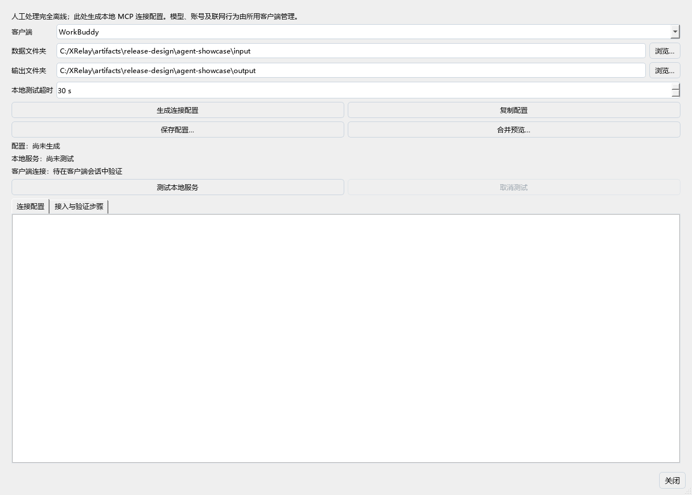

# 用 AI 助手调用 XRelay

XRelay 提供本地 MCP 工具接口。你在 AI 客户端中提出任务，助手调用 XRelay 查看数据、执行计算和保存结果。普通桌面处理可独立使用。

## 三步接入

1. 在 XRelay 打开 **窗口 → AI Agent 接口**。选择本次允许读取的数据目录，以及保存结果的输出目录；输出目录放在原始数据目录之外。
2. 选择对应客户端，点击 **生成连接配置**、**测试本地服务**。将生成的服务条目加入客户端的 MCP 设置，保留已有服务。提供 WorkBuddy、Codex、Claude Code、Gemini CLI、Grok Build CLI 等配置模板；其他客户端可参考通用配置。
3. 在客户端重载连接或新建会话，确认工具列表出现 `saxs-waxs-workbench`。先让助手读取工作流说明，再检查指定数据。

**DeepSeek Harness** 使用原生 MCP 桥接配置接入，需按其 Cordis 配置方式添加服务；不要直接粘贴通用 `mcpServers` JSON。**Grok Build CLI** 使用对应的 TOML 模板，不等同于 Grok 网页聊天。

客户端需支持 **本地 MCP stdio**。模型名称与客户端产品不是一回事；普通网页聊天和仅支持远程 HTTP/SSE 的入口不能直接使用此连接配置。更换 XRelay 软件目录后，重新生成配置。

## 从一个明确的任务开始

> 先读取 XRelay 的工作流说明，检查我允许目录中的文件和帧。列出已经具备和仍缺少的几何参数，不要猜测波长、像素尺寸、中心或 SDD。确认后按 q 做径向积分，保留原始文件，输出曲线、参数汇总和处理说明，并告诉我结果位置和失败项目。

已有处理文件内嵌几何时可继续使用；其余数据应明确提供实验参数。方位角积分还需确认径向范围，拟合需确认模型与范围。批量处理前先检查代表图及曲线。

## 查看结果

后台任务返回编号，可查询进度和结果位置；取消在样品处理间隙生效。积分数据导出一个 XLSX 工作簿，包含 **曲线数据、参数汇总、处理说明**。结果文件写入选定输出目录的独立运行文件夹，原始数据不覆盖。

本地服务检查用于确认服务能启动和发现工具。若客户端中没有工具，核对客户端配置位置、目录权限，并重载或开启新会话。最终连接以客户端实际发现并调用工具为准。

## 数据和模型

XRelay 不内置模型订阅或 API 密钥；数值计算在本地执行。外部 AI 客户端使用的模型、费用及是否向模型发送工具内容，由其配置和你的使用方式决定。不要在公开反馈中附带密钥或未公开实验数据。

[返回发布页](index.html#agent)
