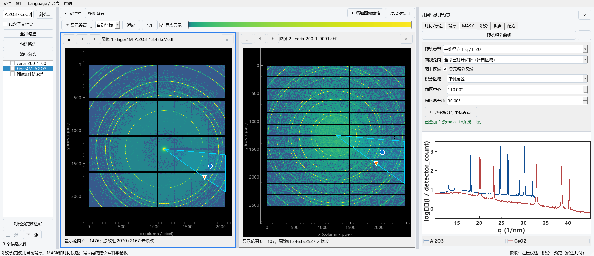

English | [简体中文](README.zh-CN.md)

# XRelay

**Click and drag, compare samples, and reuse one recipe for a batch.**

A local SAXS/WAXS workbench for detector images, multi-frame inputs, geometry, background, MASK, radial/azimuthal integration, applicable fitting and independent image export. Visual regions and curves help new users connect patterns with structure.

[Feature gallery and demonstrations](https://lpp980955-lab.github.io/XRelay/index.en.html) · [中文发布页](https://lpp980955-lab.github.io/XRelay/)

## Download and start

Version **1.0.2**: [Windows x64 complete package](https://github.com/lpp980955-lab/XRelay/releases/download/v1.0.2/XRelay-1.0.2-Windows-x64.zip) · [Corresponding sources](https://github.com/lpp980955-lab/XRelay/releases/download/v1.0.2/XRelay-1.0.2-corresponding-source.zip) · [SHA-256](https://github.com/lpp980955-lab/XRelay/releases/download/v1.0.2/SHA256SUMS.txt). This first release offers only the latest complete Windows x64 package and corresponding sources, not older binaries or a patch. Extract the whole folder and run XRelay.exe. No separate Python or AI account is needed for routine desktop processing. Keep dependencies, notices, sources and the offline manual.

Prepared release assets and hashes are in [release.json](release.json). The release uses the XRelay licence for eligible original material; file sizes and hashes are listed with the release assets. The app is unsigned. Current isolated engineering checks used Windows 11 x64, not a second computer or clean VM.

## What you can do

- Inspect geometry, reference rings and automatic candidates; save named templates.
- Apply background/MASK settings and compare multiple checked samples without opening every 2D pane.
- Move annuli or sectors; compare full-ring, single-sector and symmetric-sector integrations. Full-precision curves update on release.
- Edit curve styles, legends, fonts and axis ticks; preview and export curve/2D images and data with chosen names.
- Save/reload recipes, process selected files/frames and inspect progress and failures.
- Optionally connect an external AI client through local MCP stdio using the same processing core.

| SAXS azimuthal profiles | WAXS azimuthal profiles |
|---|---|
|  |  |

GIF timing is edited, not a benchmark. Some demonstrations use candidate geometry. Paths/names in authorized research visualizations are redacted; raw research arrays are not distributed. The user has confirmed retaining the gallery. Origins are recorded; independent third-party written permission is not claimed.

## Before processing

Verify wavelength, distance, beam centre, pixel size, background/exposure, MASK and units. Test representative inputs before sharing a recipe. Keep linked HDF5 files together and preserve raw data. Review model ranges, assumptions and residuals. Display colour and axis changes are distinct from integration bins and corrections.

[Data and analysis scope](DATA_COVERAGE.en.md) · [Methods and references](METHODS.en.md) · [Verification scope, Chinese](VERIFICATION.md)

## Optional AI

Templates include WorkBuddy, Codex, Claude Code, Gemini CLI and Grok Build CLI. DeepSeek Harness uses a native MCP bridge; other clients have generic templates where applicable. Templates do not establish end-to-end compatibility for every version. Ordinary web chat is not a local MCP client. Account costs, network access and information sent to a model depend on that client. [Connection guide](AGENT_QUICKSTART.en.md).

## Licence and citation

Developer signature: **Jiutian Zhang**, an established pen name. The XRelay Free Use and Redistribution Licence1.0 allows academic/enterprise use and commercial data processing and requires permission for selling renamed/repackaged software versions. It applies only to eligible original material; third-party rights and prior lawful grants remain unchanged. [Full terms](LICENSE).

Suggested citation: Jiutian Zhang. *XRelay*, version actually used [Computer software]. 2026. [Version release](https://github.com/lpp980955-lab/XRelay/releases/tag/v1.0.2). No software DOI or software paper is assigned. Cite the scientific methods and data actually used; the citation suggestion is not an added condition on existing GPL copies.

## Help and source

Use the bundled offline manual. For feedback or licensing enquiries, use [project GitHub Issues](https://github.com/lpp980955-lab/XRelay/issues). [Issue template, Chinese](.github/ISSUE_TEMPLATE/bug_report.md). Diagnostics remain local unless you export and share them; review private paths, names and keys first.

[Build instructions](BUILD.md). Corresponding source materials are a separate release attachment; an automatic GitHub snapshot does not replace all required upstream source materials. Software updates are manual. No automatic checking, installing or diagnostic uploading is enabled.

[Bilingual release notes](RELEASE_NOTES_BILINGUAL.md) · [Citation metadata](CITATION.cff)
