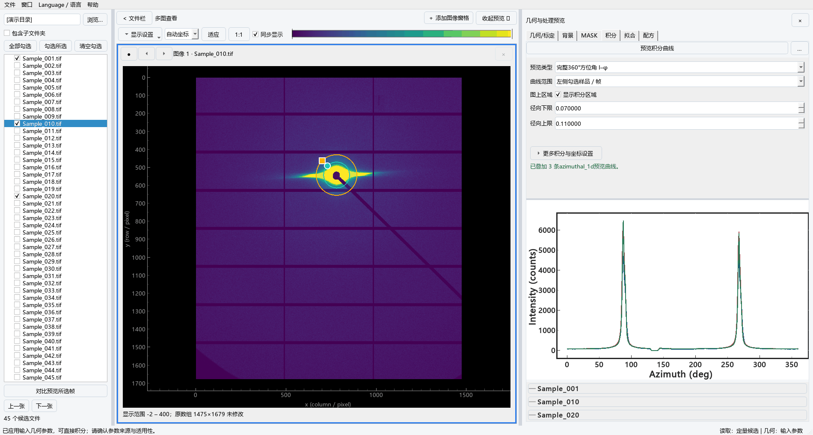
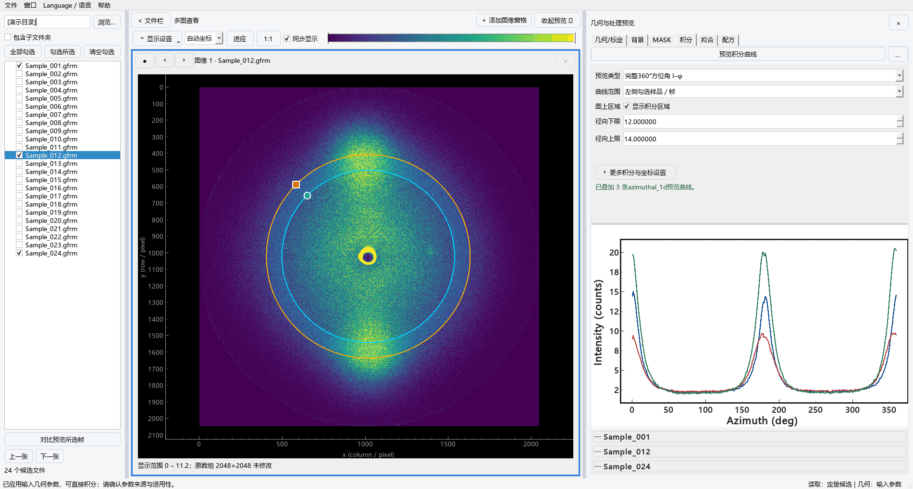
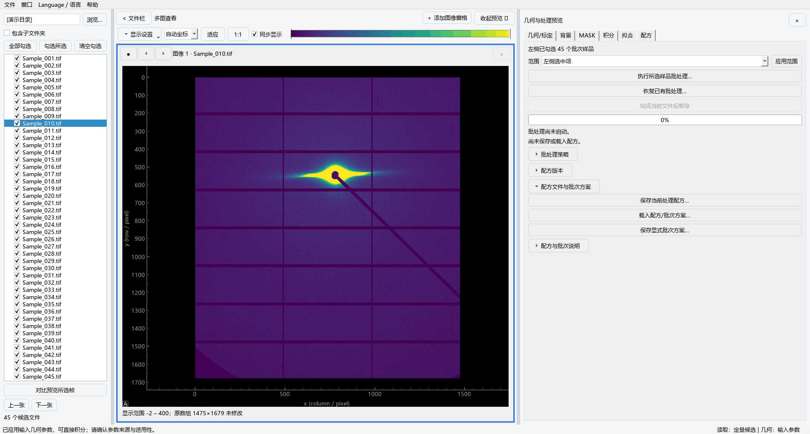

[English](README.md) | 简体中文

# XRelay

**点选拖动，无需写代码；多样品联动预览，一套配方批量出结果。**

本地 SAXS/WAXS 多样品、多帧处理工作台：几何、背景、MASK、径向与方位角积分、适用拟合及成品图导出。二维图、选区与曲线联动，方便新手上手并辅助理解结构与散射信号。

## 开始使用

[下载最新版完整包](https://github.com/lpp980955-lab/XRelay/releases/download/v1.0.2/XRelay-1.0.2-Windows-x64.zip) · [对应源码](https://github.com/lpp980955-lab/XRelay/releases/download/v1.0.2/XRelay-1.0.2-corresponding-source.zip) · [SHA-256](https://github.com/lpp980955-lab/XRelay/releases/download/v1.0.2/SHA256SUMS.txt)。新用户下载完整包，完整解压后运行 XRelay.exe，不要只复制 EXE；无需另装 Python，普通桌面处理无需 AI 账号。版本1.0.2。本次只提供最新版完整包，不发布旧版或补丁；后续按维护需要提供更新，不自动检查或安装更新。

1. 导入数据，勾选文件与帧；HDF5 master 与关联 data 文件保持完整。
2. 确认几何、背景和 MASK，先预览，再保存配方批处理。
3. 对比多条曲线，在独立成品预览中调整样式，导出数据或图片。

## 分类演示

| SAXS 方位角 | WAXS 方位角 |
|---|---|
|  |  |

匿名数据按授权展示处理图，原始数组不发布。几何为演示候选；拖动时区域跟随，松开后更新完整精度曲线。GIF停留时间经过编辑，不作为性能测试。

### 多曲线与二维图导出

### 配方批处理

## AI 为可选功能

[接入步骤与客户端说明](AGENT_QUICKSTART.md)。外部客户端通过本地 MCP 复用处理核心；模型联网和读取哪些内容由客户端配置及授权决定。提供配置模板不表示所有客户端与版本均已实测。

## 范围、反馈与源码

- [数据覆盖与条件](DATA_COVERAGE.md)；原始数据只读，几何、背景和科学模型需结合实验确认。
- [问题反馈模板](.github/ISSUE_TEMPLATE/bug_report.md)。软件本地记录诊断、由用户主动导出，不自动上传。分享前检查敏感信息。
- 离线图文手册随完整包提供。样式/几何库为原电脑用户设置，换电脑需核对路径和实验条件。
- [源码构建说明](BUILD.md)。原创部分采用XRelay免费使用与再分发许可1.0，允许免费使用，改名包装销售须书面授权；第三方组件保留原许可。
- 论文方法中注明实际版本、发布地址与处理步骤；当前没有软件 DOI 或软件论文。不复制其他项目的许可条款。
- [素材来源与使用范围](ASSET_SOURCES.json)。按用户确认保留选定素材，记录用户提供标样库与官方数据下载来源；仅展示处理图，不附原始数据。

- [本版实际验证范围](VERIFICATION.md)；[附件大小与校验值](release.json)。

## 开发者与引用

开发者：**张久天**（笔名）。问题及授权联系通过项目 GitHub Issues。

推荐引用：张久天. XRelay（实际使用版本）[计算机软件]. 2026. [对应版本发布地址](https://github.com/lpp980955-lab/XRelay/releases/tag/v1.0.2)；当前无软件 DOI。

[下载使用与注意事项](index.html#installation) · [处理方法与来源](METHODS.md)

[中英文版本说明](RELEASE_NOTES_BILINGUAL.md) · [机器可读引用信息](CITATION.cff)
