[English](README.md) | 简体中文

[完整设计版展示页](https://lpp980955-lab.github.io/XRelay/) · [下载 XRelay 1.0.2](https://github.com/lpp980955-lab/XRelay/releases/tag/v1.0.2)

# XRelay

多样品联动预览，一套配方批量出结果

常用处理无需编写代码，通过点选、拖动和参数面板即可完成。
联动查看二维图案、积分选区与曲线，边处理，边理解散射与衍射数据。

- [**点选拖动，无需写代码** 从选帧、设置参数到积分与导出，以图形操作串起常用流程，方便新手上手。](https://lpp980955-lab.github.io/XRelay/#workflow)

- [**边处理，边理解图案** 对照二维图、积分选区和曲线变化，辅助理解微观结构与散射／衍射信号的联系。](https://lpp980955-lab.github.io/XRelay/#multi-preview)

- [**多样品联动对比** 同步调整选区，集中比较多条积分曲线。](https://lpp980955-lab.github.io/XRelay/#multi-preview)

- [**调好一次，整批复用** 几何、背景、MASK 与积分存成配方，按文件和帧批量处理。](https://lpp980955-lab.github.io/XRelay/#batch)

- [**从积分到成品图** 独立高清预览，边调样式边看效果，批量导出数据与图片。](https://lpp980955-lab.github.io/XRelay/#presentation)

- [**桌面操作，也可交给 AI** 可选 MCP 接口，让外部 Agent 复用同一处理核心。](https://lpp980955-lab.github.io/XRelay/#agent)

Windows x64 便携版 · 本地处理 · 免费使用 · 改名包装销售须授权

完整三栏工作台：文件与选帧 / 两种标样与同步积分区域 / 参数与多条曲线 · 点击看原图

[几何与处理预览](https://lpp980955-lab.github.io/XRelay/#geometry-preview) · [背景与 MASK](https://lpp980955-lab.github.io/XRelay/#preparation) · [SAXS](https://lpp980955-lab.github.io/XRelay/#saxs) · [WAXS](https://lpp980955-lab.github.io/XRelay/#waxs) · [曲线与二维图导出](https://lpp980955-lab.github.io/XRelay/#presentation) · [配方批量处理](https://lpp980955-lab.github.io/XRelay/#batch)

## 几何与处理预览

右侧面板是工作台的处理入口：几何/标定、背景、MASK、积分、拟合、配方。先在标样图上检查几何，再把确认后的设置用于后续处理。

**01 / 几何参数与理论环联动**  修改中心 X → 理论环移动 → 修改 SDD → 套用参数模板恢复

### 几何输入与叠环检查

波长、SDD、束心、像素尺寸与标样种类集中设置；理论环叠到实测圆环上，直接检查位置变化。参数和预览不会改写原始图像。

### 三点定环与自动建议

可用三点定环辅助确定几何，也可获取自动中心/SDD候选，再人工检查。当前理论环与自动建议有零倾角适用范围，不声称任意几何全自动标定。

[查看自动建议界面](https://raw.githubusercontent.com/lpp980955-lab/XRelay/main/assets/standard-auto-calibration.png)

### 命名参数库与套用

保存常用几何，支持更新、重命名和删除；切换模板后先核对数据条件，再应用。上面的动图实际执行了模板载入和数值恢复。

[查看参数保存界面](https://raw.githubusercontent.com/lpp980955-lab/XRelay/main/assets/standard-geometry-template.png)

公开 AgBh 标样；本段使用零倾角理论环预览近似，不是新的定量标定报告。动图捕获真实控件变化后的界面，停留时间经过编辑，不是拖动性能实录。

### 两种标样同屏，积分区域同步联动

Al₂O₃、CeO₂ 分别使用各自配套的几何参数。拖动一个窗格的扇区，其余窗格同步角度和开角，右侧叠加两条实际积分曲线。不同探测器保留各自束心与尺寸。二维采用参考图的蓝绿—亮黄配色，各图显示范围独立，仅调整颜色映射。

**单侧扇形**  拖动方向手柄，两次改变扇区方向，两个选区同步移动，松开后刷新两条曲线。

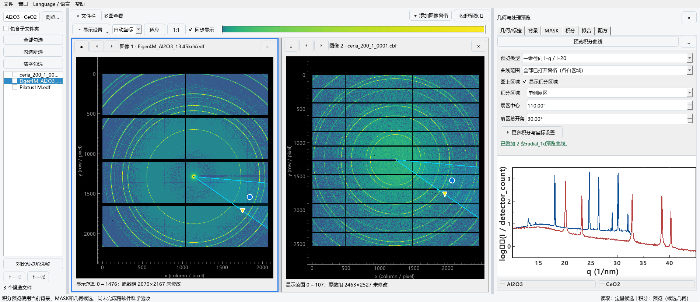

**对称扇形**  成对扇区保持180°对称，拖动方向后两个窗格同步，右侧重新积分。

**全环积分**  从对称扇形切换至全环：取消方向选区，使用完整方位范围重新积分。全环没有方向手柄。

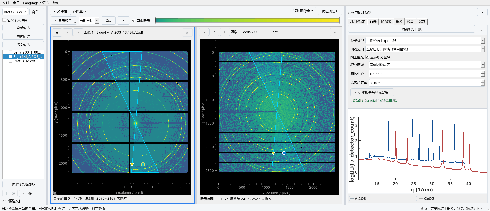

扇形动图记录离屏 Qt 鼠标按下、移动和松开的真实控件响应；拖动时同步选区，松开后计算完整精度曲线。停留时间经过编辑，不作性能计时。曲线展示 q=10–45 nm⁻¹ 范围并使用 log₁₀(I)，未经强度归一化，不据此比较不同实验的绝对强度。

**右侧六个处理入口**  几何/标定 → 背景 → MASK → 积分 → 拟合 → 配方

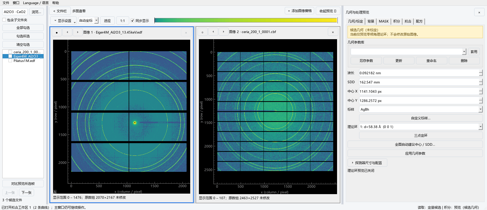

拟合入口打开独立拟合工作区；[查看实际单峰拟合操作示例](https://raw.githubusercontent.com/lpp980955-lab/XRelay/main/assets/standard-fit-workspace.png) 。背景与配方的执行示例见下方对应流程。

## 内置标样库与自定义标样导入

内置常用标样的理论峰位，支持导入自定义 d-spacing。选定标样后，自动提取测试图中的圆环并匹配理论峰位，给出几何参数候选，再叠环确认。以下按 SAXS、WAXS 展示参考图案，点击查看大图。

### SAXS 标样

**AgB · 库中标样** 
指定标样库

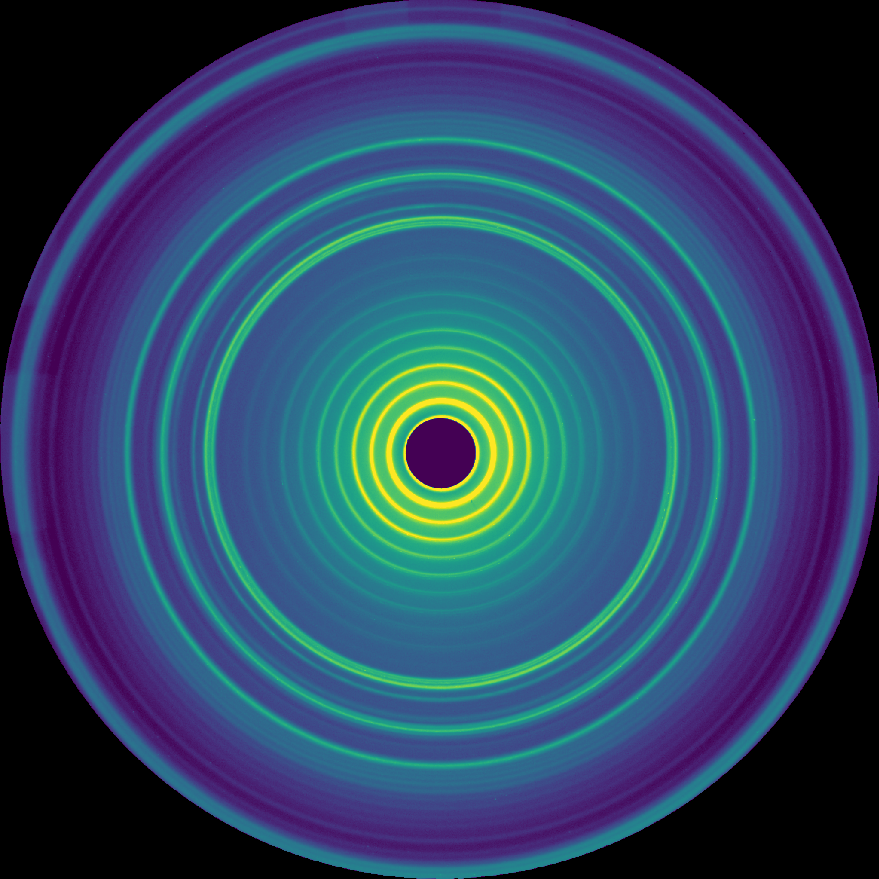

**Silver Behelate · 多级圆环** 
指定标样库

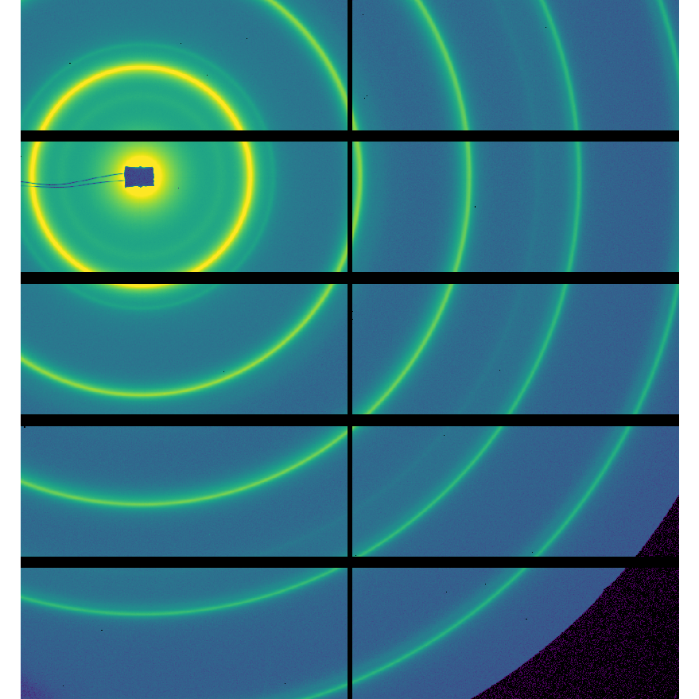

**AgBh · 官方公开标样** 
pyFAI 官方公开数据

### WAXS 标样

**CeO₂ · 偏心多环** 
指定标样库

**CeO₂ · 居中圆环** 
指定标样库

**CeO₂ · 长曝光图案** 
指定标样库

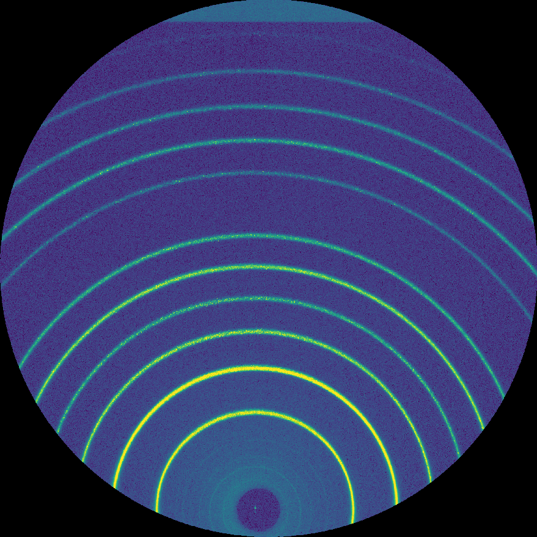

**LaB₆ · 多级衍射环** 
指定标样库

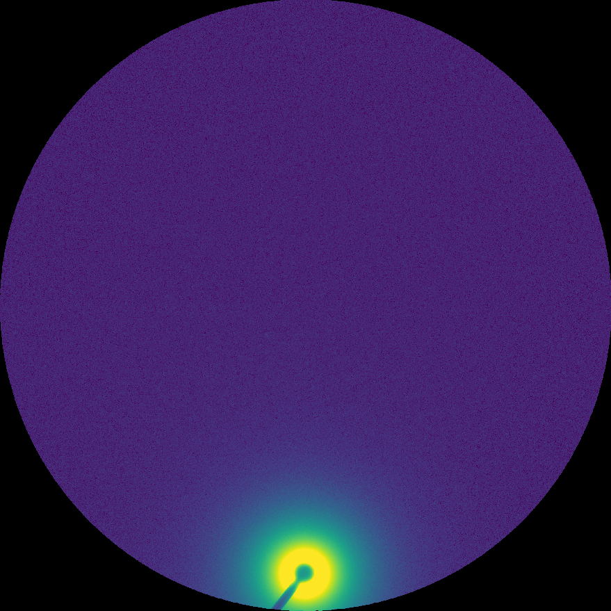

**Si · 库中标样** 
指定标样库

**Y₂O₃ · 库中标样** 
指定标样库

**α-Al₂O₃ · 官方公开标样** 
pyFAI 官方公开数据

### 其他参考图案（物质身份待核）

**bull-20s_002 · 参考图案** 
指定标样库

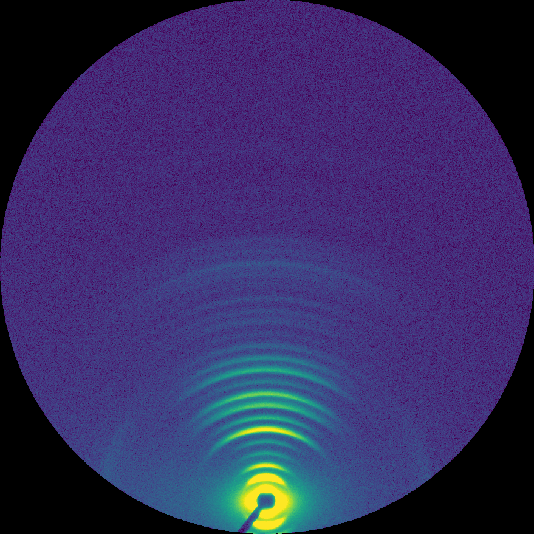

**Bull-20s_025 · 偏心参考图案** 
指定标样库

统一 viridis 色图与对数显示，按各图有效像素的1–99.5百分位独立设定色阶；图像未旋转、补绘或平滑。名称按库中文件标识，其他参考图案未强行归类。来源按用户提供的标样库和官方参考数据分别记录；展示处理图，不附原始数据。

## 背景与 MASK，继续衔接同一流程

### 自动扣背景，条件明确后复用

选定背景文件及帧，按已知曝光处理；曝光未知时明确等曝光假设。当前截图仅演示操作：使用显式命名的合成恒定背景，不冒充实测配对空白。

### 自动 MASK 候选与手动修改

建议束挡、支撑杆等排除区，结合外部 MASK 与手绘区域检查。无效区域排除，不补绘缺失信号。

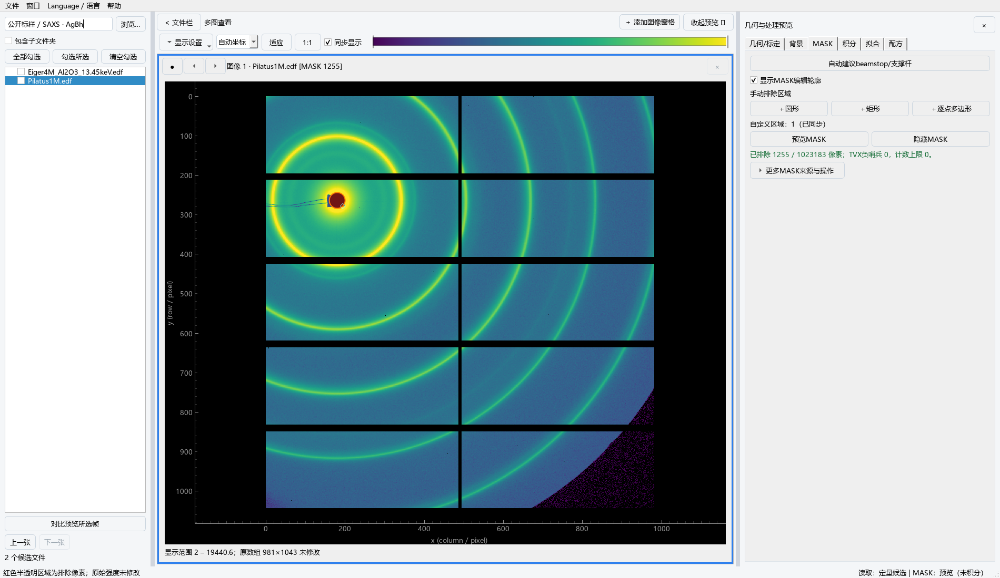

## SAXS：改变选区，看清取数位置

银山嵛酸盐 AgBh 公开标样，使用配套几何。比较三个扇区角度，二维选区与实际径向曲线一起更新；曲线使用 log₁₀(I) 显示。

**01 / 径向积分与区域联动**  参数、二维图、曲线同屏

此动图通过区域参数更新触发真实计算，等待结果完成后编排停留时间；不是鼠标拖动或响应速度实录。软件支持图上拖动选区，松开后更新完整精度曲线。

### SAXS 方位角：勾选多个样品，拖动圆环比较曲线

左侧勾选 3 个不同样品，共用当前环带。调整内、外圆环后，同时查看 3 条方位角曲线的变化。

**SAXS / 多样品方位角积分**  勾选样品 → 拖动环带 → 多曲线联动

真实数据与原生界面，名称、路径已脱敏；统一紫—蓝绿—黄色图。拖动时选区跟随，松开后更新完整精度曲线。使用演示几何候选，未将其作为定量分析结论。遮挡与探测器缝隙不作信号补全。

## WAXS：从衍射环到径向曲线

公开氧化铝标样，读取配套几何并执行全环积分。依据原教程排除大于65000的无效像素；原始文件不改写。两类演示统一使用 viridis 色图、对数显示和有效像素百分位色阶，各自范围独立，颜色不代表跨样品的相同强度。

**02 / WAXS 实际积分**  原始标样与几何来自官方教程

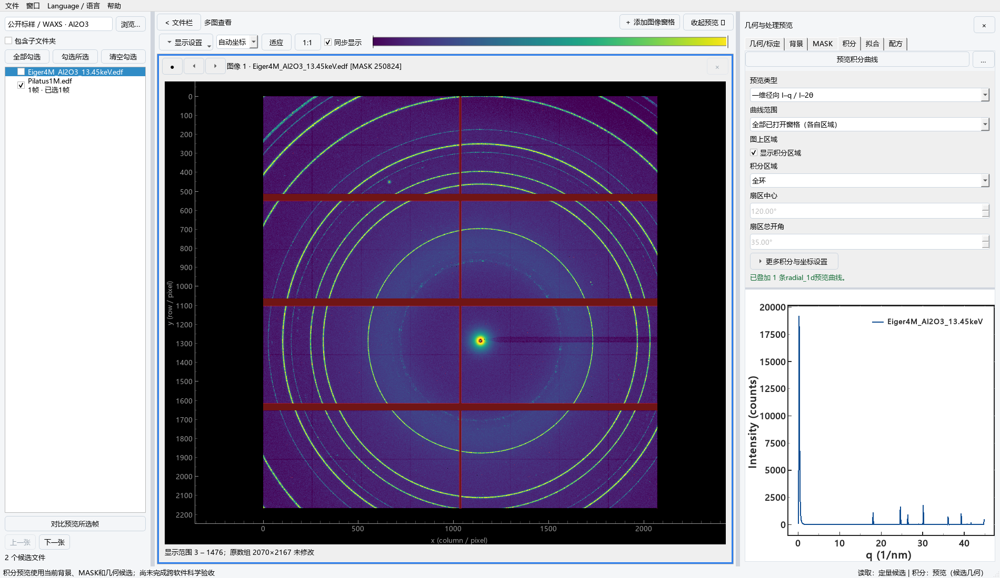

### WAXS 方位角：勾选多个样品，拖动圆环比较曲线

左侧勾选 3 个不同样品，共用当前环带。调整内、外圆环后，同时查看 3 条方位角曲线的变化。

**WAXS / 多样品方位角积分**  勾选样品 → 拖动环带 → 多曲线联动

真实数据与原生界面，名称、路径已脱敏；统一紫—蓝绿—黄色图。拖动时选区跟随，松开后更新完整精度曲线。使用演示几何候选，未将其作为定量分析结论。方位角 0° 与 360° 是同一方向，跨边界的峰会分别显示在两端。

## 曲线与二维图导出

**03 / 曲线样式与独立预览**  勾选四条实际 AgBh 分区积分曲线，修改线宽，导出图片与数据

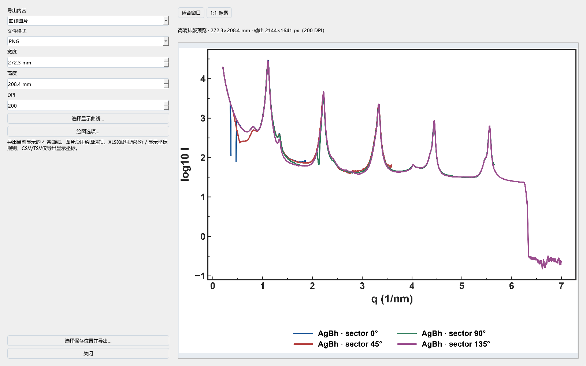

曲线颜色、线型、字体、图例与四轴刻度集中修改；数据与图片分别导出，可自主命名。曲线图片采用 Arial 粗体与协调缩放的版面样式。

**04 / 二维图片格式即时预览**  字体大小、刻度字号、框线粗细变化，预览保持固定尺寸

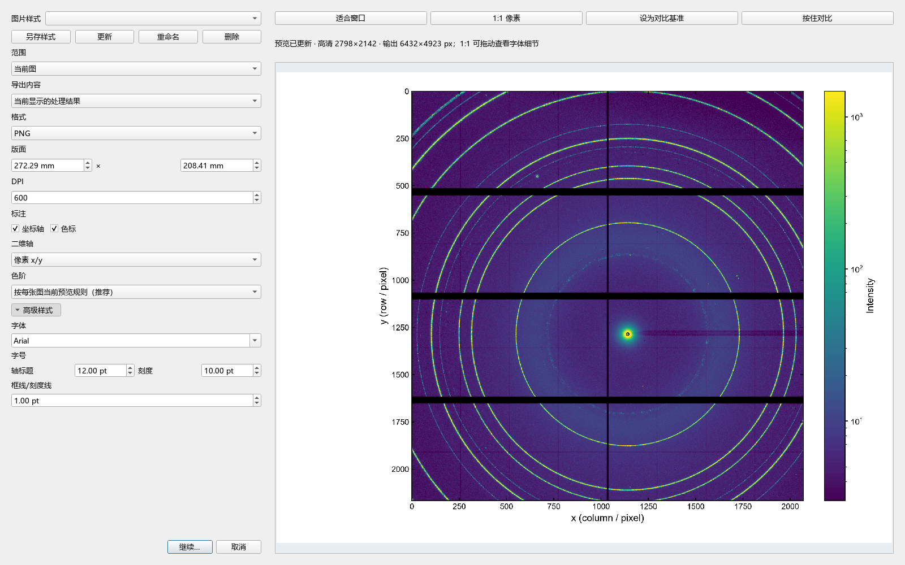

**二维图配色对比**  Viridis → Magma → Cividis → 恢复 Viridis

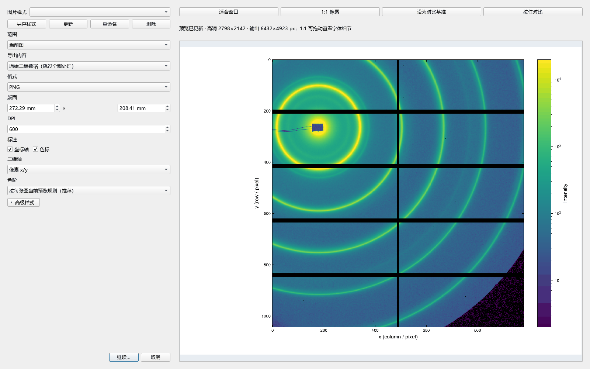

在主界面显示设置切换配色，再打开二维图导出预览查看对应成品；保持相同版面、色阶规则和数据。默认演示仍保留紫—蓝绿—黄色阶。

**批量导出二维图**  左侧勾选三个标样 → 设置共同图片格式 → 实际导出 3/3

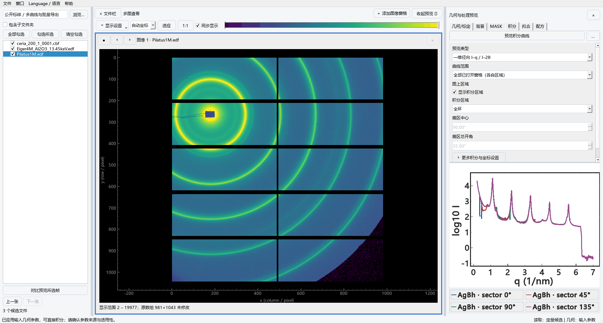

曲线演示导出四条实际积分曲线的合并图片与 XLSX；二维批量演示导出三个不同标样图片。实际结果已在本地核对，动图停留时间经过编排。

二维图片可保存多套命名样式。此处直接展示现有控件的实际效果；二维导出的粗体及四轴刻度选项尚未完整提供，不与曲线绘图选项混为一谈。

## SAXS：大批量文件，共用一套处理配方

保存几何、背景、MASK 和积分设置，重新载入后勾选整批文件执行。逐项查看进度和失败状态，完成后对比代表曲线，按来源汇总全部结果。

**批处理 / 从整批勾选到结果对比**  45 个不同文件 → 真实处理进度 → 完成 45/45 → 查看代表曲线

本次实际处理 45 个不同文件，共用同一套方位角积分参数；结束时展示3 条代表曲线，完整结果均已导出。样品名、目录与输出路径已脱敏。动图停留时间经过编排，不作为耗时测试。

## 三步完成一次处理

01 / 导入与选帧

### 只处理你需要的数据

选择或拖入文件与文件夹，按样品和帧勾选。master 与关联 data 文件保持原相对位置。

02 / 确认与预览

### 把处理条件设清楚

检查几何、背景与 MASK，确定积分区域。复用命名几何参数，切换帧后沿用当前处理流程。

03 / 对比与导出

### 让结果便于使用

多条曲线对比，批量处理，导出数据或成品图片。自定名称，保留样品、帧和单位信息。

## 覆盖哪些数据？

从二维探测器图、多帧实验文件或已有一维曲线开始。输入格式与分析方法分别说明。

### 二维 SAXS / WAXS

科研 TIFF、HDF5 / NeXus；其他 IMG、GFRM/SFRM、CBF、EDF 按适配器范围。检查几何、背景和 MASK，进行径向或方位角积分。

### 多帧与多样品

明确选择数据集和帧，勾选、比较曲线、共享参数批处理。HDF5 master 与其关联 data 文件须保持完整。

### 已有一维曲线

TXT / CSV / TSV / DAT，明确映射列、单位与曲线类型，进入适用的拟合和分析。XLSX 是结果导出格式。

部分格式主要完成构造测试，厂商变体需代表文件验证。XRD 专有原始扫描、完整 Rietveld 与 GISAXS/GIWAXS 专门分析不在当前宣传范围。[查看具体格式、分析任务与条件](https://github.com/lpp980955-lab/XRelay/blob/main/DATA_COVERAGE.md)

## 把批处理交给你的 AI 助手

连接支持本地 MCP 的 AI 客户端，让助手查看数据、核对处理参数，再调用 XRelay 完成积分、拟合与结果导出。计算复用桌面端的处理核心，结果保留数据来源与参数。

### 先看清数据

读取文件、数据集、帧数与已有几何。参数缺失时先确认，按明确的实验条件组织处理任务。

### 把步骤连成流程

径向与方位角积分、适用的峰拟合、二维导出和 SAXS 分析，通过同一个本地接口调用。

### 结果便于复核

查询后台进度，查看失败项目，获取含曲线、参数汇总和处理说明的工作簿；原始数据保持只读。

**可以这样提出任务** 
“检查这批标样的数据和配套几何，缺失参数先问我；确认后按 q 做径向积分，导出曲线、参数和处理说明。”

**演示 / 从读取标样到积分结果**  查看输入 → 提交任务 → 获取曲线和工作簿

使用公开 AgBh 标样及其配套几何。动图是实际 MCP 工具响应与导出结果的流程回放，停留时间经过编排。

### 选目录，生成配置，接入客户端

在“窗口 → AI Agent 接口”中选择允许读取和输出的目录，生成对应配置，检查本地服务，再加入客户端。

提供 WorkBuddy、Codex、Claude Code、Gemini CLI、Grok Build CLI 等连接配置模板；DeepSeek Harness 使用原生 MCP 桥接配置接入。客户端须支持本地 MCP stdio。

[查看接入步骤与示例任务 →](https://github.com/lpp980955-lab/XRelay/blob/main/AGENT_QUICKSTART.md)

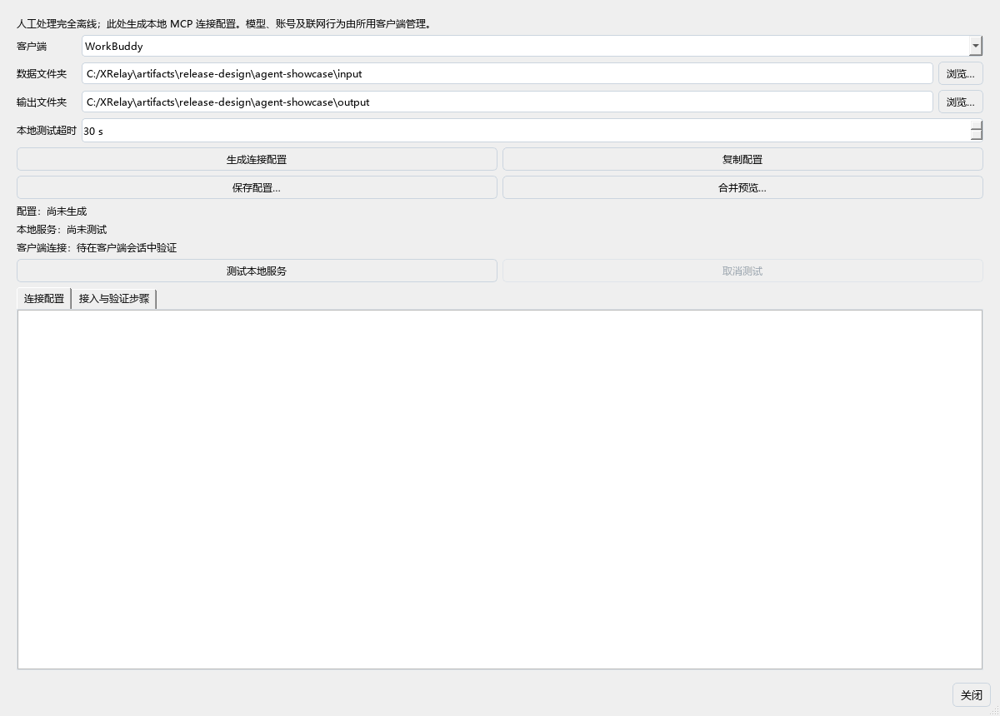

AI 为可选功能；常规桌面处理无需模型账号。模型与联网由所用客户端管理，向模型提供哪些内容取决于其配置和使用方式。

XRelay 1.0.2 · Windows x64

## 选择适合你的下载方式

本次仅发布最新版 1.0.2 完整包，不提供旧版与补丁下载。普通桌面处理无需 AI 账号，也无需另装 Python。

### Windows 完整包

完整解压后运行 XRelay.exe，保留同目录运行依赖与手册。最新版完整包 261.3 MB；实测环境与范围见版本说明。

[下载 Windows 完整包](https://github.com/lpp980955-lab/XRelay/releases/download/v1.0.2/XRelay-1.0.2-Windows-x64.zip)

### 对应源码

提供与本版一致的项目源码、构建说明、配套上游源码和许可。源码包 106.3 MB，不是运行程序。

[下载对应源码](https://github.com/lpp980955-lab/XRelay/releases/download/v1.0.2/XRelay-1.0.2-corresponding-source.zip)

### 操作手册与校验

中文离线图文手册随完整包提供；下载后核对附件 SHA-256，再完整解压运行。

[查看附件清单与校验值](https://github.com/lpp980955-lab/XRelay/blob/main/release.json)

本次仅提供最新版完整包与对应源码；下载后核对 SHA-256。[查看附件大小与 SHA-256](https://github.com/lpp980955-lab/XRelay/blob/main/release.json) ，[查看本版变化与验证范围](https://github.com/lpp980955-lab/XRelay/blob/main/RELEASE-v1.0.2.md) 。

**手动下载，按需更新。**  本次仅提供最新版完整包。后续根据维护情况发布新版本完整包或指定基础版本的补丁；软件不自动检查或安装更新。

### 本地诊断，主动反馈

诊断在本地记录，不自动上传。出现卡顿、报错或显示问题时，提供版本、显示缩放与复现步骤；诊断 ZIP 由你主动导出，提交前检查敏感内容。

### 使用许可与方法透明

允许学术与企业使用及商业数据处理；未经书面许可，不得将软件或修改版改名、重新包装后作为软件产品销售。[使用与再分发许可](https://github.com/lpp980955-lab/XRelay/blob/main/LICENSE) 。该许可仅适用于有权另行授权的原创部分；第三方组件保持各自许可，既有授权不追溯撤销。

## 下载与使用

本次仅提供最新版 1.0.2 完整包及对应源码，不发布旧版或补丁。完整解压 Windows x64 便携包后运行 `XRelay.exe`，无需另装 Python；请保留同目录的依赖、手册、源码与许可材料。

### 首次启动

先用一个代表样品核对几何、背景、MASK 和曲线，再保存配方批处理。程序尚未代码签名；下载后先核对发布附件的 SHA-256。不要关闭系统安全防护来运行来源不明的文件。

### 运行与数据兼容

本次实测 Windows 11 x64；其他系统、厂商格式变体和不同电脑需进一步验证。HDF5 master 与关联 data 文件保持完整及原相对位置。

[数据与处理范围](https://github.com/lpp980955-lab/XRelay/blob/main/DATA_COVERAGE.md)  · [本版验证范围](https://github.com/lpp980955-lab/XRelay/blob/main/VERIFICATION.md)

### 外部客户端与源码

普通处理不依赖外部 AI。Agent 功能另配支持本地 MCP 的客户端，账号、费用及网络由客户端管理。`corresponding-source.zip` 是对应源码附件，不是运行包；GitHub 自动生成的源码快照不替代完整对应源码材料。

[AI 接入说明](https://github.com/lpp980955-lab/XRelay/blob/main/AGENT_QUICKSTART.md)

中文离线图文手册随完整包提供。未来是否发布新完整包或指定基础版本补丁，按维护情况决定；软件不自动检查或安装更新。

## 使用前须知

### 1 / 几何与模板

确认波长、SDD、束心及像素尺寸。自动建议和理论环需要结合标样检查；更换实验条件后重新核对。演示参数不替代实测标定。

### 2 / 背景与 MASK

核对背景帧、尺寸、曝光和数据单位，检查坏点、束挡及支撑杆区域。不要仅凭画面好看判断处理正确；遮挡区域不代表测到了零强度。

### 3 / 计算与显示

积分径向单位决定计算分箱，曲线横纵坐标设置决定显示变换。比较曲线时保持几何、分箱、修正与归一化条件一致；配色和显示色阶不改变原始计数。

### 4 / 批处理与备份

先检查代表样品，再共享配方。载入配方后核对输入路径、背景及 MASK，检查失败项目。保留原始数据与处理参数，不把图片导出当成原始数值备份。

### 5 / 模型与解释

拟合需检查范围、残差和模型假设。SAXS 模型及取向分析有各自适用条件；导出成功不等于结构解释已被验证。

### 6 / 隐私与反馈

常规计算在本地完成，诊断不自动上传。使用外部 AI 时检查其数据授权。反馈包含版本、缩放、复现步骤与主动导出的诊断；分享前去除路径、样品名、密钥等敏感内容。

## 处理方法与参考来源

以下说明计算与展示的来源。发表研究时，请同时引用实际采用的方法、模型和数据来源；依赖软件的许可证与科学引用分别保留。

### 几何与积分

径向积分调用 pyFAI；像素分割、径向点数、积分区域及可选修正由实际设置决定。几何输入和 PONI 约定应按探测器条件核对。

[pyFAI 方法论文](https://doi.org/10.1107/S1600576715004306)  · [几何说明](https://pyfai.readthedocs.io/en/stable/geometry.html)

### 图像读取与拟合

FabIO 参与探测器格式读取，HDF5 使用 h5py；不是所有厂商变体均已验证。峰拟合使用 SciPy 最小二乘求解，物理模型与峰数仍需选择和检查。

[FabIO 方法论文](https://doi.org/10.1107/S0021889813000150)  · [求解器说明](https://docs.scipy.org/doc/scipy/reference/generated/scipy.optimize.least_squares.html)

### SAXS 与取向分析

Guinier 在选定区间拟合 ln(I)–q²；Porod 分析拟合 ln(I)–ln(q) 的斜率。Herman 相关计算需核对参考方向、角度覆盖及缺失区域；界面名称不构成模型适用性证明。

[完整处理说明与来源](https://github.com/lpp980955-lab/XRelay/blob/main/METHODS.md)

图片与动图由 XRelay 实际界面捕获，播放停留时间经过编排，不是性能计时。色图和色阶仅用于显示，各图独立色阶不表示相同绝对强度。匿名数据不附原始数组或身份映射。

## 下载前，你可能还想知道

### 新手从哪里开始？

完整解压后运行 XRelay.exe，不另装 Python，常规处理不需要 AI 账号。从导入、确认几何、预览一条曲线开始，再复用配方批处理。

[查看三步流程](https://lpp980955-lab.github.io/XRelay/#workflow)

### 数据会自动上传吗？

常规桌面计算在本地进行，诊断不自动上传。启用外部 AI 时，模型能读取哪些内容、是否联网，由客户端配置与授权决定。

[查看 AI 接入说明](https://github.com/lpp980955-lab/XRelay/blob/main/AGENT_QUICKSTART.md)

### 结果或界面有问题？

记录版本、系统、显示缩放与复现步骤，主动导出诊断报告。先检查敏感信息，再按反馈模板提交，不需要公开整个实验文件夹。

[问题反馈模板](https://github.com/lpp980955-lab/XRelay/blob/main/.github/ISSUE_TEMPLATE/bug_report.md)

更新由用户手动下载；换电脑时需重新核对输入路径和实验几何。具体数据格式、条件和范围见 [数据覆盖说明](https://github.com/lpp980955-lab/XRelay/blob/main/DATA_COVERAGE.md) 。

## 用于研究，注明版本与处理步骤

在方法中注明使用的 XRelay 版本、实际发布地址，以及几何、背景、MASK、积分方式和所用算法。这样既便于引用，也便于复现。开发者署名：张久天。推荐引用：张久天. XRelay（实际使用版本）[计算机软件]. 2026. 对应版本发布地址。[XRelay 1.0.2 发布地址](https://github.com/lpp980955-lab/XRelay/releases/tag/v1.0.2) ；当前无软件 DOI。

开发者：张久天 · 问题与授权联系：项目 GitHub Issues。

外部标样来源：[pyFAI AgBh 教程](https://www.silx.org/doc/pyFAI/latest/usage/cookbook/calibration_with_jupyter.html) [pyFAI 氧化铝教程](https://www.silx.org/doc/pyFAI/latest/usage/cookbook/integration_with_python.html) [pyFAI CeO₂ / LaB₆ 参考数据](https://www.silx.org/pub/pyFAI/testimages/) 。图像由 XRelay 实际处理与捕获。展示素材按用户确认保留，来源分别为用户提供的标样库及所列官方数据入口；仅展示处理图，不分发原始数据。

[GitHub 中文首页](https://github.com/lpp980955-lab/XRelay/blob/main/README.zh-CN.md) [版本发布稿](https://github.com/lpp980955-lab/XRelay/blob/main/RELEASE-v1.0.2.md) 
XRelay · 1.0 系列 · 本地桌面处理，无外部脚本、字体或统计请求。

## 源码与版本材料

[源码构建](BUILD.md) · [对应源码与校验附件](https://github.com/lpp980955-lab/XRelay/releases/tag/v1.0.2) · [实际验证范围](VERIFICATION.md) · [引用信息](CITATION.cff)
